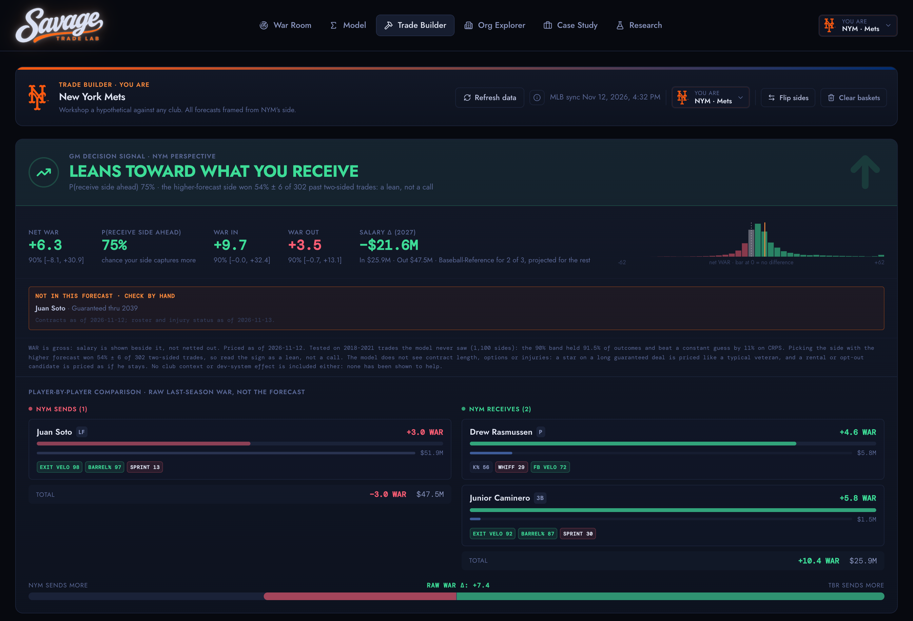
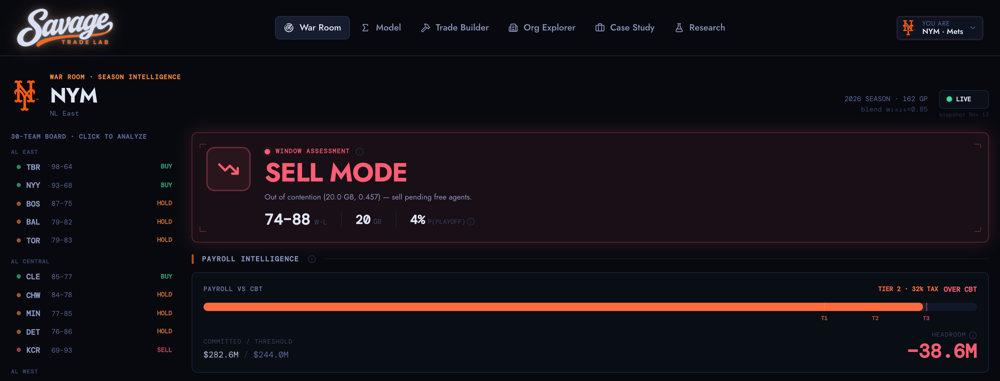

<p align="center">
  
</p>

# Savage Trade Lab

Most trade-value tools price a player once and sell that number to all 30 clubs.
This one prices the trade for the club that receives him. A cost-controlled
starter is worth more to a contender with a hole in the rotation than to a
rebuilder, and a player is only worth what the acquiring club will actually get
from him before he leaves. The output is a forecast distribution of the WAR each
side captures, scored on trades the model never saw. Around it sit a deadline War
Room, a Trade Builder, an organization explorer, and a pipeline that refreshes
the data every morning and refuses to publish when the data looks wrong.

<p align="center">
  
</p>

---

## What it found

The honest result is smaller than the first one, and more useful.

| Question | Answer |
|---|---|
| Can a model beat simple baselines on trades it never saw? | Yes. A four-feature structural model beats both a median null and the training distribution on a 2018-2021 holdout: MAE 1.079 vs 1.127 (4.3% better), CRPS 0.867 vs 0.975 (11.1% better), with 91.5% of outcomes inside the 90% interval. n = 1,100 trade sides, trained on pre-2018 only. |
| Does club context help? | Not measurably. The 34 context features (contention window, payroll, farm depth, front-office history) are worse than the median null on their own and add nothing on top of the structural model. Pre-registered tests of context as a multiplier on playing time and retention, and of roster displacement (the closest call, +1.1% CRPS with an interval spanning zero), never earned a look at the holdout. A planted effect of 10% of held WAR is detected by the same pipeline, so anything that large would have shown. |
| Can it tell you who wins a trade? | Barely. The side with the higher forecast captured more WAR in 54% ± 6 of 302 two-sided trades. The app shows that as a lean, never a call. |
| Was the original 28.2% "beat" real? | No. It scored a model trained through 2022 on 2018-2021 trades and compared it to the training mean. Refit out of sample and compared to the median, that model loses to predicting zero. The correction is committed alongside the result it replaced. |

The target is the WAR a player earns **for the receiving club** from the trade
season through five years after, summed per side. The earlier target counted WAR
earned anywhere, skipped the first two seasons where 44% of captured value lands,
and was 43% zeros. Details and every intermediate table:
[`docs/evaluation.md`](docs/evaluation.md).

---

## The product

<p align="center">
  
</p>

- **War Room.** Pick a club and get its window (buy, hold, sell) from record,
  games back and playoff odds, payroll against the luxury-tax tiers, a three-year
  payroll projection, positional needs against farm depth, and a five-year
  contention grid.
- **Trade Builder.** Build any trade between two clubs. The forecast panel shows
  each side's captured WAR with a 90% interval, the probability your side comes
  out ahead, salary from Baseball-Reference, and a **Not in this forecast**
  list: opt-outs, options and long guarantees the model cannot see.
- **Org Explorer and Org Scout.** All 30 clubs on a development-versus-trade map,
  with front-office personnel and GM behavior profiles.
- **Player Profile, Case Study, Research.** WAR trajectories and Statcast
  percentiles, a worked trade, and the research log behind every modeling choice.

The browser forecast is a TypeScript port of the Python model, held to it by 55
golden cases with a maximum absolute error of 5e-13 (`npm run check:structural`).
One model, two runtimes, no drift. More screens in the
[product tour](docs/product-tour.md).

---

## Data you can trust on a Tuesday

Every source is public. 61 sources are cataloged in
[`ingest/catalog.py`](src/savage_trade_evaluator/ingest/catalog.py): 45 ingested,
12 available but not wired, 4 blocked, each with the reason. Statcast comes from
Baseball Savant, WAR and contracts from Baseball-Reference, transactions,
rosters, standings and free agency from the MLB Stats API, Steamer projections
and prospect grades from FanGraphs, payroll from Spotrac.

A daily job on an always-on Mac runs at 05:30:

1. **Ingest** 16 steps. A command that exits 0 but reports zero rows counts as a failure.
2. **Gate** on what the database now holds, not on what the commands said:
   every current-season table must have been rewritten by this run, standings
   must show 30 clubs with possible records, every roster must have 25 or more
   players, the newest transaction must be under a week old, and no table, WAR
   total, games-played maximum or win total may shrink against the last good run.
3. **Export and build** only if no blocking gate failed. The new site replaces
   the old one with two renames, so a failed run leaves yesterday's site serving.
4. **Publish a status file** either way. The footer shows its age and any lagging
   source, so a refresh that quietly did nothing cannot look healthy.

Sources that are allowed to lag (Spotrac, contract terms) warn instead of block.
The gates exist because each one caught a real failure: current-season rows that
re-ingests had silently stopped updating, a roster fetch that truncated to 183
players and exited 0, and a payroll source that went stale.

---

## The constraints that forced the design

**There are almost no trades.** About 5,300 trade sides across 2010-2024, a few
hundred new ones a year, and the MLB Stats API has essentially nothing usable
before 2010. No engineering makes more of them.

**The noise is roughly twenty times the effect.** Per-trade residual sigma is
1.41 WAR; between-organization variance is 0.066. So: shrinkage, distributions
rather than point estimates, scoring on CRPS and interval coverage rather than
R-squared, and a feature counts only when its 90% interval excludes zero with at
least 95% of posterior mass on one side.

**Every source is public and several resist being read.** Baseball-Reference
rate-limits to about 20 requests a minute; FanGraphs blocks scrapers outright.
So: one adapter per source, raw pulls cached to disk, ingests restartable by
season, and fetchers that refuse partial results instead of writing them.

**One person, one database file, no server.** A single DuckDB file with 58
tables and 44 views. The frontend reads committed JSON exports and never talks to
Python at runtime, so the product runs from a clone with no database and no keys.

---

## Architecture

```
public sources              ingest/ (one adapter each)      storage/
  MLB Stats API             cached, restartable,            DuckDB, one file
  Baseball-Reference   ->   refuse partial results     ->   58 tables + 44 views
  Baseball Savant                                           current-season rows
  FanGraphs, Spotrac                                        refresh on re-ingest
  Retrosheet, Chadwick
                                     |
                                     v
             quality.py gates  <-  refresh.py (daily, launchd 05:30)
                                     |
                                     v
                      modeling/structural.py
                      two-part: P(side captures any WAR)
                      x ridge on the rest + empirical residuals
                      graded by scripts/benchmark_vs_naive.py
                                     |
                +--------------------+--------------------+
                v                                         v
       ste CLI: score-trade,                     scripts/export_*.py
       suggest-trades, ingest, ...                        |
                                                          v
                                          React SPA, committed JSON,
                                          same model in TypeScript,
                                          served on the tailnet
```

---

## Hard problems

**A primary key that silently dropped half the data.** MLB's API reuses one
transaction id across every leg of a trade, and the table keyed on that id alone.
`ON CONFLICT` quietly discarded the second and third legs of every multi-player
trade. Fixed with a composite key and a per-trade leg index. No error, no
warning, just a smaller table.

**A benchmark that graded itself.** The headline 28.2% improvement scored a
model on trades it had trained on and compared it to a mean when the honest
baseline was a median. Refit out of sample, it lost to predicting zero. The fix
was to rebuild from the simplest model that could work and only add what beat
it on pre-2018 folds before touching the holdout.

**A 3.2-sigma finding that was regression to the mean.** The project began from
a thesis that one club's development system inflates players who then regress
once traded. Adding pedigree controls collapsed the effect 25x. About 97% of the
raw signal was regression to the mean
([R-10](docs/research/part-2-origin-org-and-the-metric-correction.md)).

**Re-ingests that never updated anything.** `INSERT ... ON CONFLICT DO NOTHING`
meant the current season froze at whatever the first pull of the year saw. Every
re-ingest reported success. Current-season tables now upsert, and the freshness
gate checks that the rows were actually rewritten.

**A fix that improved the headline metric and was rejected.** Multiple
imputation brought sparse-row interval coverage onto nominal and made CRPS 15-17%
worse, because independent draws ignore how missing features move together.
Verdict NO-GO, and the [report](docs/revalidation/2026-07-post-mi.md) is
committed for the same reason passing ones are.

---

## Known limitations

- **It prices trades; it cannot say whether one would be accepted.** Refused
  proposals are not public, so there are no negative examples to learn from.
- **Contracts are outside the model.** A star on a long guarantee is priced like
  a typical veteran, and a rental or opt-out candidate as if he stays. The UI
  lists these players under *Not in this forecast* instead of hiding the gap.
- **Club context adds nothing measurable yet.** The thesis that one player has
  thirty prices is what the product is built around; the data does not yet
  support it beyond who controls the player and for how long.
- **These are effects on trades that happened, not on trades in general.** GMs
  chose these deals, so naive comparisons are biased by selection.
- **The rate-based outcomes are underpowered.** 629 labeled rows for
  xwOBA-delta and 255 for K%-delta; treat those findings as directional.
- **Spotrac contract terms lag.** The daily run marks them degraded rather than
  blocking on them.

---

## Running it

The frontend runs from a clone, with no database and no keys:

```bash
cd frontend && npm install && npm run dev    # http://localhost:5173
```

The pipeline needs `uv sync`, then `uv run ste init` and the ingests
(`uv run ste catalog --status ingested` lists them). The daily job is
`uv run python scripts/refresh_daily.py`; `--gates-only` checks the data
without changing anything. Deployment to an always-on Mac is in
[`docs/imac-cutover.md`](docs/imac-cutover.md).

---

## Documentation

| Doc | What it covers |
|---|---|
| [`docs/evaluation.md`](docs/evaluation.md) | Benchmark design, the target redefinition, R-64 and R-65, every table |
| [`docs/architecture.md`](docs/architecture.md) | Module layout, CLI surface, the ingest-to-product path |
| [`docs/STATS_CATALOG.md`](docs/STATS_CATALOG.md) | Every data source, its status, and row counts |
| [`docs/research/`](docs/research/README.md) | The experiment log, mostly nulls |
| [`docs/product-tour.md`](docs/product-tour.md) | Every screen and what it does |
| [`docs/imac-cutover.md`](docs/imac-cutover.md) | Daily refresh, quality gates, deployment |

Analytical framing draws on *The MVP Machine*, *Baseball Between the Numbers*,
*Statistical Rethinking* and *Causal Inference: The Mixtape*.

---

## License

Source-available for evaluation, research, and education. Reading is permitted;
copying, redistribution, commercial use, and ML training on the source are not,
without prior written permission. See [`LICENSE`](LICENSE). For commercial
licensing: **rob.savage@me.com**.
