<p align="center">
  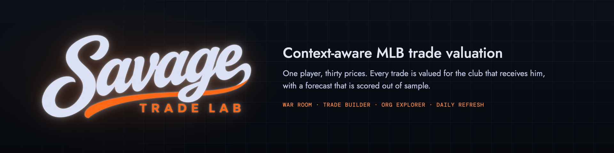
</p>

# Savage Trade Lab

Most trade-value tools price a player once and sell that number to all 30 clubs.
This one prices the trade for the club that receives him. A cost-controlled
starter is worth more to a contender with a hole in the rotation than to a
rebuilder, and a player is only worth what the acquiring club will actually get
from him before he leaves. The output is a forecast distribution of the WAR each
side captures, scored on trades the model never saw.

Around the model sits a deadline War Room, a Trade Builder, an organization
explorer, and a pipeline that refreshes the data every morning and refuses to
publish when the data looks wrong. It is one person's project, built end to end:
ingestion, a 430 MB analytical store, a statistical model, its evaluation harness,
a React front end, and the deployment that keeps it running.

<p align="center">
  
</p>

## Contents

1. [At a glance](#at-a-glance)
2. [What it found](#what-it-found)
3. [The product](#the-product)
4. [How the model works](#how-the-model-works)
5. [Data you can trust on a Tuesday](#data-you-can-trust-on-a-tuesday)
6. [The constraints that forced the design](#the-constraints-that-forced-the-design)
7. [Architecture](#architecture)
8. [Hard problems](#hard-problems)
9. [How the project evolved](#how-the-project-evolved)
10. [Known limitations](#known-limitations)
11. [Running it](#running-it)
12. [Testing and verification](#testing-and-verification)
13. [Documentation](#documentation)

---

## At a glance

| | |
|---|---|
| **Question** | What will each club capture from a trade, as a distribution, and can that beat naive baselines on trades it never saw? |
| **Answer** | Yes, narrowly, with four features. Club context adds nothing measurable. |
| **Holdout** | 2018-2021, 1,100 trade sides, trained on pre-2018 only |
| **Beat the median null by** | 4.3% on MAE (1.079 vs 1.127) |
| **Beat the training distribution by** | 11.1% on CRPS (0.867 vs 0.975), with 91.5% of outcomes inside the 90% interval |
| **Data** | 61 cataloged sources (45 ingested), 58 tables and 44 views in one DuckDB file, 854,000 transaction legs |
| **Code** | 23 ingest modules, 85 scripts, 188 test functions, 13,400 lines of TypeScript, 10 routes |
| **Runs** | Daily at 05:30 on an always-on Mac, behind 24 quality gates, served on a private tailnet |

---

## What it found

The honest result is smaller than the first one, and more useful.

| Question | Answer |
|---|---|
| Can a model beat simple baselines on trades it never saw? | Yes. A four-feature structural model beats both a median null and the training distribution on a 2018-2021 holdout: MAE 1.079 vs 1.127 (4.3% better), CRPS 0.867 vs 0.975 (11.1% better), with 91.5% of outcomes inside the 90% interval. |
| Does club context help? | Not measurably. The 34 context features (contention window, payroll, farm depth, front-office history) are worse than the median null on their own and add nothing on top of the structural model. Pre-registered tests of context as a multiplier on playing time and retention, and of roster displacement (the closest call, +1.1% CRPS with an interval spanning zero), never earned a look at the holdout. A planted effect of 10% of held WAR is detected by the same pipeline, so anything that large would have shown. |
| Can it tell you who wins a trade? | Barely. The side with the higher forecast captured more WAR in 54% ± 6 of 302 two-sided trades. The app shows that as a lean, never a call. |
| Was the original 28.2% "beat" real? | No. It scored a model trained through 2022 on 2018-2021 trades and compared it to the training mean. Refit out of sample and compared to the median, that model loses to predicting zero. The correction is committed alongside the result it replaced. |

<p align="center">
  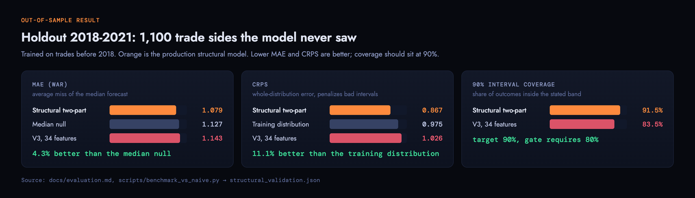
</p>

The target is the WAR a player earns **for the receiving club** from the trade
season through five years after, summed per trade side. The earlier target counted
WAR earned anywhere, skipped the first two seasons where 44% of captured value
lands, and was 43% zeros. Details and every intermediate table:
[`docs/evaluation.md`](docs/evaluation.md).

<p align="center">
  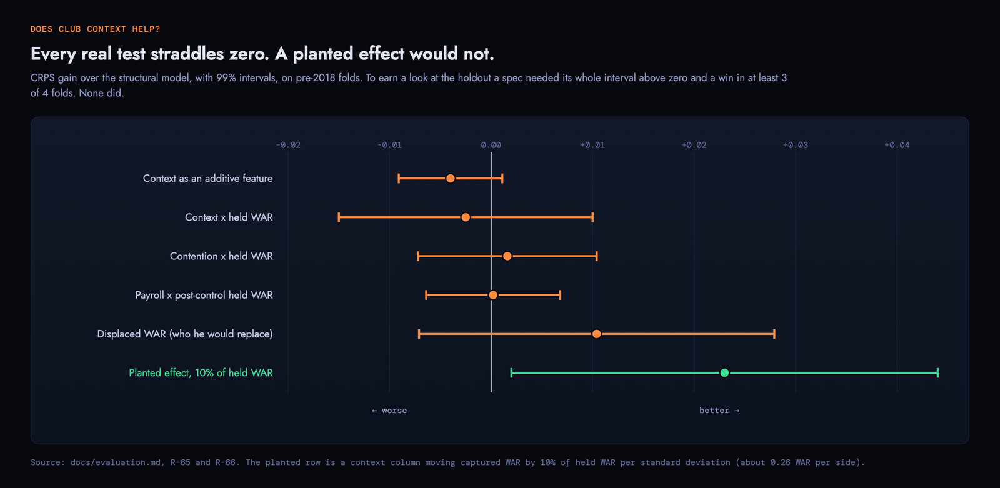
</p>

---

## The product

### War Room

Pick a club and get its window (buy, hold, sell) from record, games back and
playoff odds, payroll against the luxury-tax tiers, a three-year payroll
projection, positional needs against farm depth, and a five-year contention grid.

<p align="center">
  
</p>
<p align="center">
  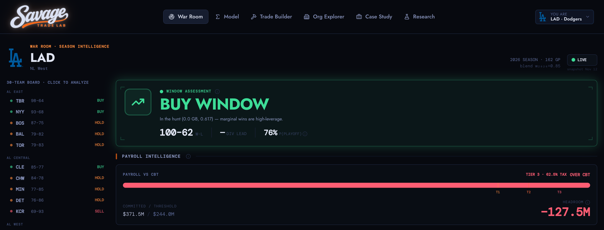
</p>

### Trade Builder

Build any trade between two clubs. The forecast panel shows each side's captured
WAR with a 90% interval, the probability your side comes out ahead, salary from
Baseball-Reference, and a **Not in this forecast** list: opt-outs, options and long
guarantees the model cannot see. The verdict is worded as a lean ("leans toward
what you receive") because the higher-forecast side won only 54% ± 6.

The browser forecast is a TypeScript port of the Python model, held to it by 55
golden cases with a maximum absolute error of 5e-13 (`npm run check:structural`).
One model, two runtimes, no drift.

### Model

The in-app version of the evaluation: the holdout scoreboard read live from the
benchmark's own output, the spec ladder, the context tests, and the correction.

<p align="center">
  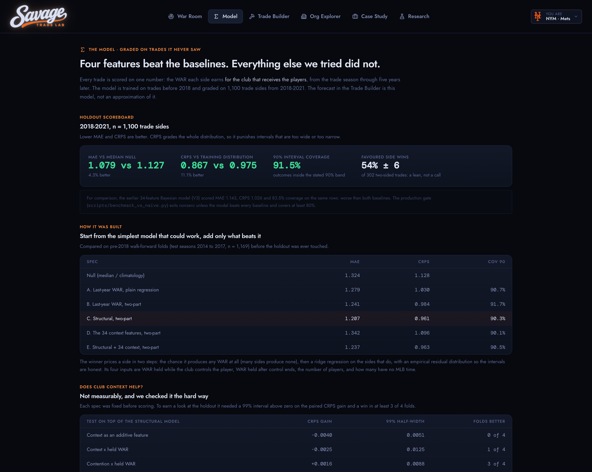
</p>

<details>
<summary><b>Org Explorer, Org Scout, Player Profile, Case Study, Research</b></summary>

<br>

**Org Explorer.** All 30 clubs on a development-versus-trade map: one axis is how
much WAR a club's system adds to players it develops, the other how much surplus it
extracts in trades. The two turn out to be roughly uncorrelated.

<p align="center">
  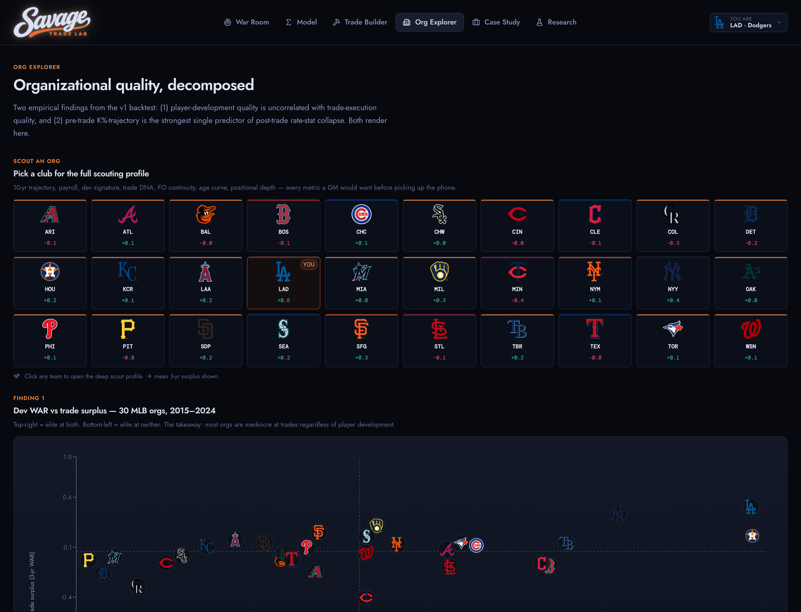
</p>

**Org Scout.** A club's front office, personnel history, GM behavior profile and
positional depth in one place.

<p align="center">
  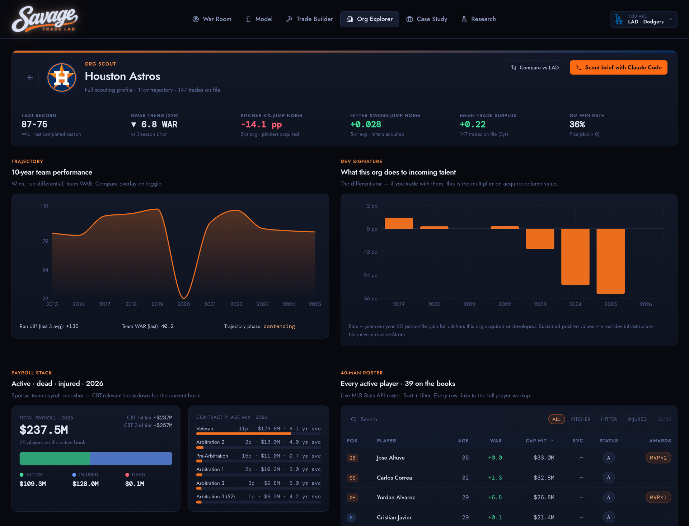
</p>

**Player Profile.** WAR trajectory against salary, Statcast percentile radar, every
trade the player has been in, and rate-stat trends.

<p align="center">
  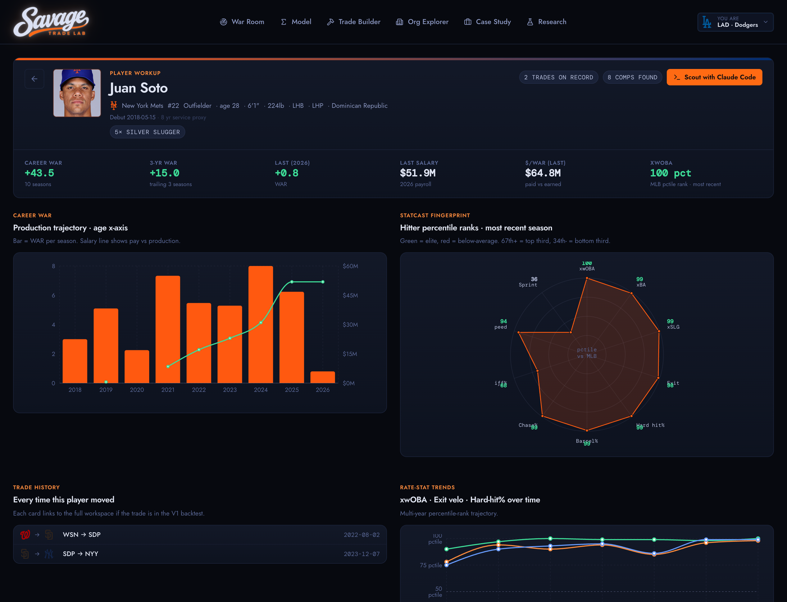
</p>

**Case Study.** The 2018 Pressly trade from Minnesota to Houston, worked through
the data layer: his fastball and curve spin barely moved (97th to 98th and 100th to
100th percentile) while K% went from the 65th to the 94th percentile. Houston
changed how he used the pitches, not the pitches. If those numbers drift, an ingest
regressed, so it doubles as a data check.

<p align="center">
  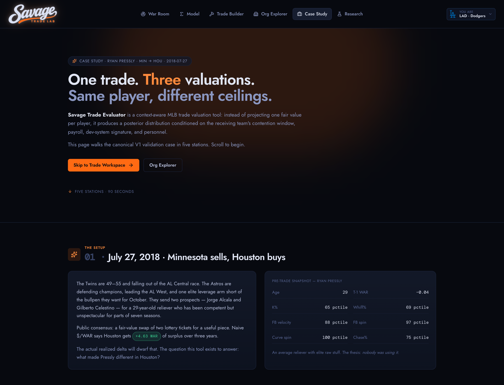
</p>

**Research.** The experiment log behind every modeling choice, mostly nulls.

<p align="center">
  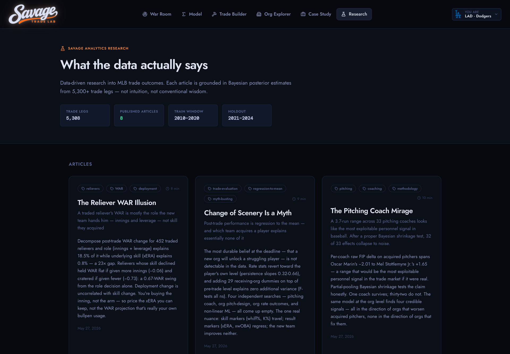
</p>

</details>

More detail on every screen in the [product tour](docs/product-tour.md).

---

## How the model works

**The target.** For each trade side, the WAR the acquired players earn for the
receiving club from the trade season (T) through T+5, summed. It is the quantity a
front office actually receives: not WAR a player earns elsewhere after being
flipped, and not WAR from the transition year thrown away.

**Two steps, because the outcome is zero-inflated.** A large share of trade sides
produce no MLB value at all (prospects who never arrive, players who leave). One
regression on the whole thing has to be wrong about both groups. So the model
estimates the probability that a side produces any WAR, then fits a ridge
regression on the sides that do, and draws from an empirical residual
distribution so the intervals reflect what the data actually looks like instead of
an assumed shape.

**Four inputs.** WAR held while the club controls the player, WAR held after
control ends, the number of players, and how many have no MLB time. Held WAR is a
3-2-1 weighted rate over the last three completed seasons times the seasons the
receiving club can expect to hold him inside the window. Nothing else survived.

**One analytic summary.** The residual pool is compressed to 200 quantile atoms, so
the mean, the 90% interval and the probability one side comes out ahead need no
random draws and are identical in Python and TypeScript. That is why the browser
can run the same model and be checked against it to 5e-13.

<p align="center">
  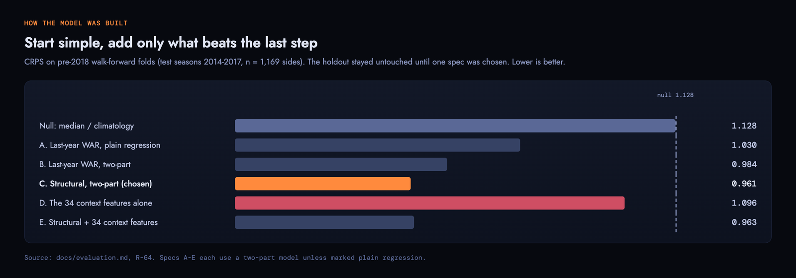
</p>

<details>
<summary><b>How a spec earns a look at the holdout</b></summary>

<br>

Specs are fixed before they are scored. A spec earns one look at the 2018-2021
holdout only if its paired per-side CRPS gain over the structural model has a 99%
interval above zero (adjusted for five comparisons) and it wins at least 3 of 4
pre-2018 walk-forward folds. If none qualifies, the holdout is not touched. That is
what happened for club context (R-65) and roster displacement (R-66): no spec
qualified, so the holdout was never used to rescue one.

To know what "nothing detectable" can and cannot mean, the same pipeline was run on
a planted effect: a context column that moves captured WAR by 10% of held WAR per
standard deviation (about 0.26 WAR per side). It is detected (CRPS gain 0.023
against a 0.021 half-width); 5% is not. So an effect that large in one of these
columns would have shown up, and smaller ones cannot be excluded at this sample
size.

One change was made after the first holdout score: the zero/non-zero classifier was
tuning its regularization on accuracy, which a unit test on separable data showed
gives poorly calibrated probabilities. It now tunes on log-loss. The decision was
made on the folds, and the holdout number is reported as it fell.

</details>

<details>
<summary><b>Leakage controls</b></summary>

<br>

- The 2018-2021 holdout is trained on pre-2018 rows for every model, including V3,
  which is refit inside the benchmark script because the cached V3 fit trains
  through 2022 and has seen the holdout. The production structural fit trains on
  2010 through 2020, the last season whose T+5 window is complete.
- Baselines are the median (MAE-optimal when 43% of the old target was exactly
  zero) and the training distribution (for CRPS), plus a linear WAR-quality
  regression. The model has to beat all of them.
- The benchmark exits nonzero if the production model loses to any baseline or its
  interval coverage falls under 80%.
- Every model-touching change is revalidated and the report is committed with its
  git SHA, pass or fail. The [NO-GO report](docs/revalidation/2026-07-post-mi.md)
  is there for the same reason the passing ones are.

Full protocol: [`docs/evaluation.md`](docs/evaluation.md) and
[`docs/EXPERIMENT_PROTOCOL.md`](docs/EXPERIMENT_PROTOCOL.md).

</details>

<details>
<summary><b>A worked example: Soto to Tampa Bay</b></summary>

<br>

A hypothetical, priced as of 2026-11-12: the Mets send Juan Soto to the Rays for
Drew Rasmussen and Junior Caminero. From the Mets' side the Trade Builder reports
WAR in of +9.7 (90% interval -0.0 to +32.4), WAR out of +3.5 (-0.7 to +13.1), and a
net of +6.3 (-8.1 to +30.9), with a 75% chance the receiving side captures more.
It says the trade "leans toward what you receive": a lean, not a call, because the
higher-forecast side has won only 54% ± 6 of past two-sided trades.

It also lists Soto under **Not in this forecast**, because his contract is
guaranteed through 2039 and the model cannot see contract length. The same trade
priced as if he were a typical veteran is exactly the mistake the panel exists to
flag. The distribution plot is drawn from the model's own atoms, so the
exact-zero case and the skew are visible instead of smoothed into a bell curve.

</details>

---

## Data you can trust on a Tuesday

Every source is public. 61 sources are cataloged in
[`ingest/catalog.py`](src/savage_trade_evaluator/ingest/catalog.py): 45 ingested,
12 available but not wired, 4 blocked, each with the reason. Statcast comes from
Baseball Savant, WAR and contracts from Baseball-Reference, transactions, rosters,
standings and free agency from the MLB Stats API, Steamer projections and prospect
grades from FanGraphs, payroll from Spotrac.

A daily job on an always-on Mac runs at 05:30:

1. **Ingest** 16 steps. A command that exits 0 but reports zero rows counts as a failure.
2. **Gate** on what the database now holds, not on what the commands said.
3. **Export and build** only if no blocking gate failed. The new site replaces the
   old one with two renames, so a failed run leaves yesterday's site serving.
4. **Publish a status file** either way. The footer shows its age and any lagging
   source, so a refresh that quietly did nothing cannot look healthy.

| Gate | Blocks publishing when |
|---|---|
| Freshness | A current-season table was not rewritten by this run (95% of bWAR rows, 70% of Statcast rows, every standings and team-stats row) |
| Standings | Not 30 clubs, or a record with more than 162 games or no wins |
| Rosters | Any club has fewer than 25 players, or fewer than 30 clubs came back |
| Transactions | The newest transaction is more than a week old |
| No shrinkage | A table, the season's WAR total, games-played maximum or win total falls below the last good run |

Sources that are allowed to lag (Spotrac, contract terms, free-agent history)
**warn** instead of block, and the run is marked *degraded*. The gates exist
because each one caught a real failure: current-season rows that re-ingests had
silently stopped updating, a roster fetch that truncated to 183 players and exited
0, and a payroll source that went stale.

<p align="center">
  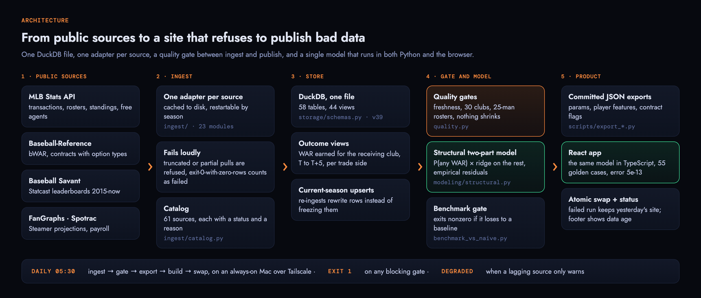
</p>

---

## The constraints that forced the design

**There are almost no trades.** About 5,300 trade sides across 2010-2024, a few
hundred new ones a year, and the MLB Stats API has essentially nothing usable
before 2010. No engineering makes more of them. So: small models, shrinkage, and a
bar for what counts as an effect that a small sample cannot clear by luck.

**The noise is roughly twenty times the effect.** Per-trade residual sigma is
1.41 WAR; between-organization variance is 0.066. So: distributions rather than
point estimates, scoring on CRPS and interval coverage rather than R-squared, and a
feature counts only when its 90% interval excludes zero with at least 95% of
posterior mass on one side.

**Every source is public and several resist being read.** Baseball-Reference
rate-limits to about 20 requests a minute; FanGraphs blocks scrapers outright.
So: one adapter per source, raw pulls cached to disk, ingests restartable by
season, and fetchers that refuse partial results instead of writing them.

**One person, one database file, no server.** A single DuckDB file with 58 tables
and 44 views. The front end reads committed JSON exports and never talks to Python
at runtime, so the product runs from a clone with no database and no keys. DuckDB
holds an exclusive write lock, so ingests serialize and everything else opens
read-only.

---

## Architecture

```
src/savage_trade_evaluator/
  ingest/        23 modules: an adapter per source, the catalog (61 sources), a shared fetch helper
  storage/       DuckDB schema (v39), views, the upsert helper that keeps
                 current-season rows fresh
  modeling/      structural.py is the production model; v3.py and friends are
                 the earlier Bayesian model, kept as the comparison
  quality.py     the gates
  refresh.py     the daily job: ingest, gate, export, build, swap, status
  cli.py         the `ste` command line (score-trade, suggest-trades, ingest, ...)
scripts/         85 scripts: benchmarks, experiments (r33 to r66), exports
frontend/        React + TypeScript app; src/data holds the committed exports
deploy/          launchd plists, the static server, the deploy script
docs/            evaluation, architecture, research log, revalidation reports
tests/           188 test functions
```

---

## Hard problems

The most useful part of a project like this is what went wrong. Each of these is a
real failure that was found, fixed, and kept from coming back.

<details>
<summary><b>A primary key that silently dropped half the data</b></summary>

<br>

The transactions table used `transaction_id` alone as its primary key. MLB's API
reuses that id across every leg of a trade, so the Pressly deal arrives as three
rows sharing id 371509. `ON CONFLICT` quietly discarded the second and third legs
of every multi-player trade in the dataset, which is most of the interesting ones.
The fix is a composite key `(transaction_id, leg_index)` plus a normalizer that
assigns sequential leg indices per shared id
([`schemas.py:57`](src/savage_trade_evaluator/storage/schemas.py)). The failure
mode is the dangerous kind: no error, no warning, just a smaller table than it
should have been.

</details>

<details>
<summary><b>A benchmark that graded itself</b></summary>

<br>

The headline 28.2% improvement scored a model on trades it had trained on and
compared it to a mean when the honest baseline was a median. 42.8% of holdout legs
had a `war_delta` of exactly zero, which makes the median the MAE-optimal constant.
Refit out of sample, the model lost to predicting zero. A local CRPS function was
also wrong (0.82 where the tested one gives 0.55 on standard-normal draws) and was
deleted. The fix was to rebuild from the simplest model that could work and add only
what beat it on pre-2018 folds before touching the holdout. The earlier report is
kept, with a header saying what was wrong with it.

</details>

<details>
<summary><b>Re-ingests that never updated anything</b></summary>

<br>

`INSERT ... ON CONFLICT DO NOTHING` meant the current season froze at whatever the
first pull of the year saw. Every re-ingest reported success and added new rows but
never updated old ones. The fix is an upsert helper that rewrites the inserted
columns (with `now()`, not the bare `CURRENT_TIMESTAMP` that DuckDB rejects in that
position, which a test caught), and a freshness gate that checks the rows were
actually rewritten rather than trusting the command's exit code.

</details>

<details>
<summary><b>A roster fetch that wrote a partial league and exited 0</b></summary>

<br>

The roster refresh wrote a seed with 183 players instead of 1,341 after
`IncompleteRead` failures for several clubs: identity-encoded responses were being
cut short in the environment the refresh ran in. The fix was a shared fetch helper that
requests gzip and retries truncated reads, bulk fetchers that refuse a partial
result, and a roster gate that fails below 25 players per club. Soto, King,
Musgrove and Tucker had all vanished from every roster, which is how it was
noticed.

</details>

<details>
<summary><b>A 3.2-sigma finding that was regression to the mean</b></summary>

<br>

The project began from a specific thesis: that one club's development system
inflates players who then regress once traded out. The raw high-cohort split
supported it at 3.2 sigma. Adding pedigree controls in a multilevel fit collapsed
the effect 25x and pushed the interval across zero. Roughly 97% of the raw signal
was regression to the mean, and any test that fails to condition on pre-trade tier
will attribute that to the origin organization
([R-10](docs/research/part-2-origin-org-and-the-metric-correction.md)). Later
rounds rejected the thesis outright: young traded players gain WAR regardless of
which organization they leave.

</details>

<details>
<summary><b>The outcome variable was hiding the features</b></summary>

<br>

Five straight rounds of feature engineering returned nulls against a WAR-surplus
target. Rerunning the identical ablation against an xwOBA-delta target moved three
features across the credibility bar at once, and R-22 produced the largest credible
coefficient in the project (-10.8 K-percentile points per standard deviation of
pre-trade K%-trajectory, 90% CI [-17.1, -4.3]) on a K% target where the same
feature was invisible on WAR
([R-19, R-22](docs/research/part-2-origin-org-and-the-metric-correction.md)). The
lesson that carried into the structural model is that the target is a modeling
decision, and it was the first thing re-examined.

</details>

<details>
<summary><b>Surplus inflated by the length of the window</b></summary>

<br>

The three-term valuation averaged salary across a player's control window instead
of summing it. On a four-year window at $10M per year it reported $10M of cost
against a correct $40M, a 4x understatement, and two-way players had their salary
counted twice on top of that. Caught in the 2026-07 trust pass and fixed with a
dedup to one row per `(mlb_id, season)` and `SUM` over the window
([D-53](docs/decision-drafts/2026-07-trust-release.md)).

</details>

<details>
<summary><b>A fix that improved the headline metric and was rejected</b></summary>

<br>

Missing features were being mean-filled, which gives intervals that are too narrow
on sparse rows. Predict-time multiple imputation fixed exactly that: 90% coverage
on sparse rows moved from 0.87 to 0.94 for `war_delta`, right onto nominal. It also
degraded CRPS by 14.5% to 16.8%, because drawing each missing feature independently
ignores the correlations between them. Verdict: **NO-GO**. The API stays in `v3.py`
for a future conditional-draw experiment and the scoring path reverted to mean-fill
([revalidation report](docs/revalidation/2026-07-post-mi.md)).

</details>

<details>
<summary><b>A deploy that shipped the repo without its own data</b></summary>

<br>

Moving the app to an always-on Mac, the sync excluded `data/` to protect the
database, and the unanchored pattern also matched `frontend/src/data/`. The build
failed with missing-module errors on files that were plainly in git. The first dry
run only checked for files that leaked through, not for files wrongly missing. The
fix anchored the pattern, and the dry run now verifies that every tracked file
outside the database directory ships. The same deploy also exposed an Intel-only
dependency (no prebuilt wheel for `llvmlite` 0.46+), fixed with a platform-scoped
lock constraint that leaves the laptop's pins untouched, and a Node too old to read
the lockfile, fixed with a user-local install that touches nothing system-wide.

</details>

---

## How the project evolved

| When | What happened |
|---|---|
| Spring 2026 | **Thesis and data spine.** Context-aware valuation: one player, many prices. 832,000 transaction legs, full bWAR, Statcast 2015-2024, front-office personnel. |
| May 2026 | **Research rounds.** Twenty-plus experiments. The development-system thesis is rejected (R-10), the outcome variable is found to be hiding features (R-19), multilevel structure is measured to add nothing (R-33 to R-35). |
| July 2026 | **Trust pass.** A salary-window bug and an imputation experiment are found and recorded, the second as a committed NO-GO. |
| Nov 12, 2026 | **The benchmark correction.** The 28.2% beat is shown to be in-sample against the wrong null. The target is redefined to captured WAR, and the structural two-part model is built from the baseline up and promoted. |
| Nov 12, 2026 | **One brain.** The same forecast on both screens, a contract blind-spot panel, Baseball-Reference salaries, and free-agent and projection ingests. |
| Nov 12, 2026 | **The daily refresh.** Quality gates, atomic site swap, status footer, and a deployment that runs without anyone at the keyboard. |

---

## Known limitations

- **It prices trades; it cannot say whether one would be accepted.** Refused
  proposals are not public, so there are no negative examples to learn from.
- **Contracts are outside the model.** A star on a long guarantee is priced like a
  typical veteran, and a rental or opt-out candidate as if he stays. The UI lists
  these players under *Not in this forecast* instead of hiding the gap.
- **Club context adds nothing measurable yet.** The thesis that one player has
  thirty prices is what the product is built around; the data does not yet support
  it beyond who controls the player and for how long. The structural model has no
  club-context term, so it cannot rank the same player differently for different
  clubs.
- **Some tools still run on the older model.** `suggest-trades`, trade cycles, and
  the buy-low engines rank on V3 or on browser-side heuristics, and are unvalidated
  until a context effect beats the structural model on the folds.
- **These are effects on trades that happened, not on trades in general.** GMs
  chose these deals, so naive comparisons are biased by selection.
- **The rate-based outcomes are underpowered.** 629 labeled rows for xwOBA-delta
  and 255 for K%-delta; the R-19 and R-22 findings are directional.
- **Prospects are not in the validated forecast.** Their FV-table value appears on
  a separate line marked unvalidated.
- **Spotrac contract terms lag.** The daily run marks them degraded rather than
  blocking on them.
- **Front-end tests are thin.** The only automated check beyond `tsc` is
  `npm run check:structural`; the rest is checked by the type system and by looking.

---

## Running it

The front end runs from a clone, with no database and no keys:

```bash
cd frontend && npm install && npm run dev    # http://localhost:5173
```

The pipeline:

```bash
uv sync
uv run ste init                              # create the DuckDB schema
uv run ste catalog --status ingested         # what data sources exist
uv run ste status                            # row counts in the store
uv run ste score-trade --receiver HOU --sender MIN --players 519151 --season 2018 --date 2018-07-27
```

The daily job, and a read-only check of the data without changing anything:

```bash
uv run python scripts/refresh_daily.py                # ingest, gate, export, build, swap
uv run python scripts/refresh_daily.py --gates-only   # run the gates against what is there now
uv run python scripts/benchmark_vs_naive.py           # the GO gate: exits nonzero on failure
```

Deploying to an always-on Mac (launchd, Tailscale, the status file) is in
[`docs/imac-cutover.md`](docs/imac-cutover.md).

---

## Testing and verification

| Check | What it covers |
|---|---|
| `scripts/benchmark_vs_naive.py` | The GO gate. Exits nonzero if the production model loses to any baseline or coverage drops under 80%. |
| `npm run check:structural` | The TypeScript forecast against 55 Python-computed golden cases; fails if they diverge. |
| CI on every push to `main` | `ruff format --check`, `ruff check`, `pyright`, `pytest`. |
| 188 test functions | Parsers tested against real payloads, the upsert helper, the quality gates, the refresh status, schema DDL. |
| Quality gates | Run on every daily refresh against the database itself. |
| Revalidation reports | Model-touching changes are revalidated against the protocol and the report is committed with its git SHA. |

---

## Documentation

| Doc | What it covers |
|---|---|
| [`docs/evaluation.md`](docs/evaluation.md) | Benchmark design, the target redefinition, R-64 to R-66, every table |
| [`docs/architecture.md`](docs/architecture.md) | Module layout, CLI surface, the ingest-to-product path |
| [`docs/STATS_CATALOG.md`](docs/STATS_CATALOG.md) | Every data source, its status, and row counts |
| [`docs/research/`](docs/research/README.md) | The experiment log, mostly nulls |
| [`docs/product-tour.md`](docs/product-tour.md) | Every screen and what it does |
| [`docs/imac-cutover.md`](docs/imac-cutover.md) | Daily refresh, quality gates, deployment |
| [`docs/PHASE1_SYNTHESIS.md`](docs/PHASE1_SYNTHESIS.md) | What survived the research phase and what did not |

Reading order. Three minutes: this page. Twenty minutes: add
[`evaluation.md`](docs/evaluation.md) for whether to believe any of it. An
afternoon: add the [research log](docs/research/README.md), starting from part 2.

Analytical framing draws on *The MVP Machine*, *Baseball Between the Numbers*,
*Statistical Rethinking* and *Causal Inference: The Mixtape*.

---

## License

Source-available for evaluation, research, and education. Reading is permitted;
copying, redistribution, commercial use, and ML training on the source are not,
without prior written permission. See [`LICENSE`](LICENSE). For commercial
licensing: **rob.savage@me.com**.
